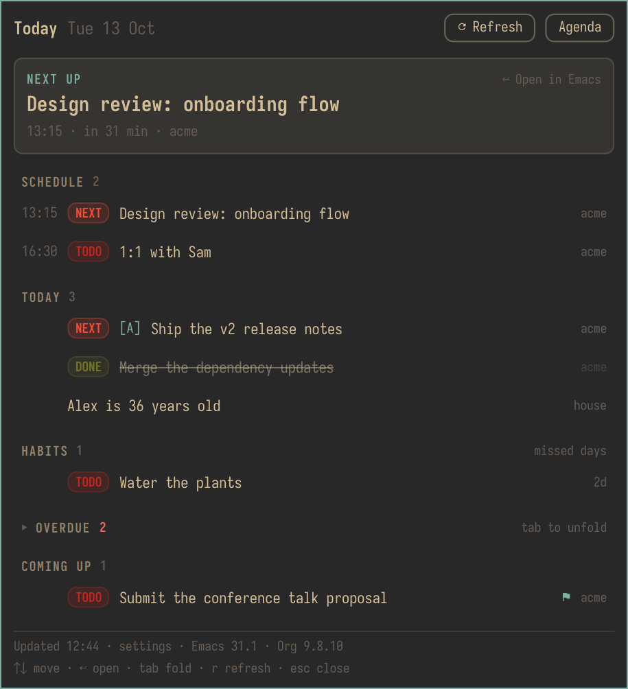

# Org Agenda for Omarchy

Today's Org agenda from your running Emacs, in the Omarchy bar. Click an
entry and Emacs opens it at its heading.




## Requirements

- Omarchy 4.0.4 or newer.
- GNU Emacs 29.1 or newer, running as a server. Any one of these works:
  `M-x server-start`, `(server-start)` in your init file, `emacs --daemon`,
  or `systemctl --user enable --now emacs`.
- Org 9.6 or newer (bundled with Emacs 29 and later).
- `emacsclient` on your `PATH`, or its full path in the `emacsclient`
  setting.

## Install

```sh
omarchy plugin add https://github.com/ovistoica/omarchy-org-agenda
```

It asks whether to enable the plugin and which bar section to put it in,
with the centre preselected. Add `--enable` to skip the enable question.

To install by hand instead:

```sh
git clone https://github.com/ovistoica/omarchy-org-agenda \
  ~/.config/omarchy/plugins/ovistoica.org-agenda
omarchy plugin enable ovistoica.org-agenda
```

## Uninstall

```sh
omarchy plugin remove ovistoica.org-agenda
```

This disables the plugin and deletes its folder. Your running Emacs keeps
the helper loaded until it restarts; `M-x unload-feature RET
omarchy-org-agenda` removes its functions and hooks right away. The plugin
never writes to your Emacs config, and its agenda file in
`$XDG_RUNTIME_DIR/omarchy-org-agenda/` is cleared when you log out.

## How it works

- The plugin loads a small elisp helper
  ([`elisp/omarchy-org-agenda.el`](elisp/omarchy-org-agenda.el)) into your
  running Emacs through `emacsclient`.
- Emacs writes today's agenda as JSON to
  `$XDG_RUNTIME_DIR/omarchy-org-agenda/`, and the bar watches that file.
- The bar never polls. Emacs pushes a fresh export whenever an Org
  buffer is saved or reverted, a TODO state changes, or an agenda
  buffer is rebuilt.
- The agenda is Org's own: Org collects the entries, so your sorting
  strategy, skip functions, habits and diary sexps all apply.

## Using it

**Bar widget**

| Click  | Action                                                       |
| ------ | ------------------------------------------------------------ |
| Left   | Open the popout                                              |
| Middle | Open your `org-agenda` in Emacs (dispatcher key `agendaKey`) |
| Right  | Ask Emacs for a fresh export                                 |

**Popout keys:** `↑`/`↓` or `j`/`k` move, `↵` opens, `r` refreshes,
`Esc` closes.

Opening an entry (click or `↵`) shows its file at the heading in the
current Emacs frame, the way `emacsclient +LINE FILE` would, and focuses
the Emacs window.

**IPC**

```sh
omarchy-shell ovistoica.org-agenda refresh   # re-export now
omarchy-shell ovistoica.org-agenda status    # status, item count, settings as JSON
omarchy-shell shell toggle ovistoica.org-agenda '{}'   # open/close the popout
```

To toggle the popout from the keyboard, bind it in
`~/.config/hypr/bindings.lua` (pick a key that is free on your system;
`omarchy menu keybindings --print` lists the taken ones):

```lua
o.bind("SUPER + ALT + O", "Org agenda", "omarchy-shell shell toggle ovistoica.org-agenda '{}'")
```

## Settings

Edit them in the widget's settings in the bar, or from a terminal:

```sh
omarchy bar set ovistoica.org-agenda label Count
```

| Key              | Type    | Default       | Meaning                                                                                                   |
| ---------------- | ------- | ------------- | --------------------------------------------------------------------------------------------------------- |
| `label`          | enum    | `"Next item"` | Bar label: `Next item` (next entry's time and title), `Count` (open entries today) or `Icon` (icon only) |
| `maxTitleChars`  | integer | `28`          | Longest title shown in the bar (10–80)                                                                    |
| `overdueBadge`   | boolean | `true`        | Show the overdue count badge                                                                              |
| `habitsInBadge`  | boolean | `false`       | Count missed habits as overdue                                                                            |
| `showDone`       | boolean | `true`        | Keep done entries in the popout, struck through                                                           |
| `pushUpdates`    | boolean | `true`        | Let Emacs push changes (installs the hooks listed below)                                                  |
| `socketName`     | string  | `""`          | Emacs server socket name or path; blank is the default socket                                            |
| `serverFile`     | path    | `""`          | Server file of a TCP Emacs server; blank uses the socket                                                  |
| `emacsclient`    | path    | `""`          | `emacsclient` binary; blank looks it up on `PATH`                                                         |
| `agendaFiles`    | string  | `""`          | Agenda files and directories, colon-separated; blank falls back to Emacs (see below)                     |
| `agendaKey`      | string  | `"a"`         | `org-agenda` dispatcher key opened by middle click and the Agenda button                                  |
| `emacsApp`       | string  | `"emacs"`     | Window class of Emacs, focused after opening an entry                                                     |
| `timeoutSeconds` | integer | `5`           | How long to wait for Emacs to answer (1–30)                                                               |

## Pinning the agenda files

The bar reads the first of these that is set:

1. the `agendaFiles` setting,
2. the Emacs option `omarchy-org-agenda-files`,
3. `org-agenda-files`.

Set `omarchy-org-agenda-files` if you have commands that narrow
`org-agenda-files` at runtime (a "work only" agenda, say) but want the bar
to always show everything:

```elisp
(setq omarchy-org-agenda-files '("~/org/agenda.org" "~/org/projects/"))
```

It takes the same forms as `org-agenda-files`: a list of files and
directories, or the name of a file that lists them.

## Privacy

The `Count` and `Icon` label modes keep task titles off the bar, which
helps while screen sharing. In `Icon` mode the tooltip leaves out titles
too.

## What it changes in Emacs

- It defines only functions and variables prefixed `omarchy-org-agenda-`.
- With `pushUpdates` on, it adds functions to `after-save-hook`,
  `after-revert-hook`, `org-after-todo-state-change-hook` and
  `org-agenda-finalize-hook`, and a variable watcher on
  `org-agenda-files`. Set `pushUpdates` to `false` and they are removed;
  the bar then refreshes when you open the popout (if the agenda is over
  a minute old), on right click and at midnight.
- `M-x unload-feature RET omarchy-org-agenda` removes everything,
  hooks included.
- It never prompts. Agenda files that don't exist are skipped and
  counted in the popout's footer.

## Troubleshooting

- **"Can't reach your Emacs server"** in the popout means `emacsclient`
  found no server. Start one (see Requirements) and press Retry.
- **Custom server:** if you named your socket (`server-name`, or
  `emacs --daemon=NAME`), set `socketName`. For a TCP server
  (`server-use-tcp`), set `serverFile` to its server file.
- **Emacs busy:** if Emacs doesn't answer in time, the bar dims to show
  the agenda is stale and retries with backoff.
- **Status:** `omarchy-shell ovistoica.org-agenda status` prints the
  status, last error, item count and effective settings.
- **Logs:** `journalctl --user -b -t omarchy-shell` (lines are prefixed
  `org-agenda:`).

## Development

```sh
tests/run.sh             # ERT in emacs --batch -Q with an isolated HOME, then the Model.js node tests
tests/check-manifest.sh  # manifest, settings schema and plugin-folder checks
```

Dev loop:

1. Symlink the repo into the plugins directory:
   `ln -s "$PWD" ~/.config/omarchy/plugins/ovistoica.org-agenda`.
2. After editing QML, run `omarchy restart shell`. Hot reload doesn't
   follow symlinks. The elisp helper is reloaded into Emacs automatically
   when it changes on disk.
3. Validate against the real path, not the symlink:
   `omarchy plugin validate ~/path/to/omarchy-org-agenda`.

Security notes:

- All Org text is rendered as plain text (`PlainText.qml`). Rich and
  styled text are never used, so markup in a heading stays literal.
- The `--eval` forms sent to Emacs are built only in `Model.js`, from
  validated paths, line numbers and IDs.
- `emacsclient` is always run with an argument vector, never through a
  shell.

## License

MIT; see [LICENSE](LICENSE).
